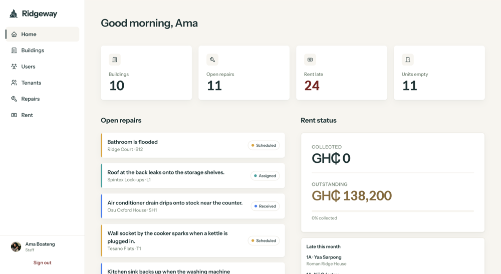
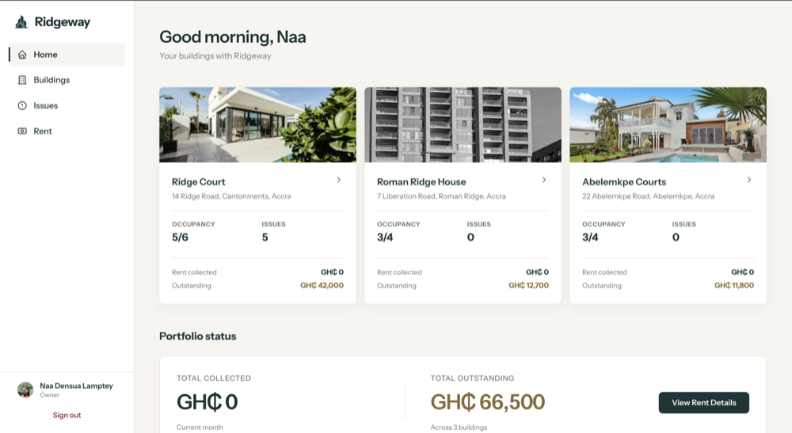
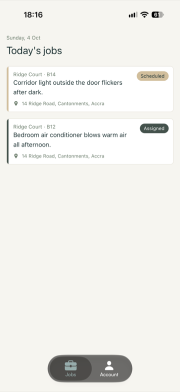
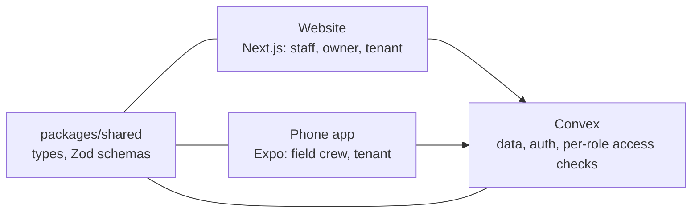

# Ridgeway

Operations software for Ridgeway Property Group: staff command center, owner portal, tenant repairs and rent status, and a field phone app.


<p>
  
  
</p>

Walkthrough and write-up: [dmstudiosgh.com/work/ridgeway](https://www.dmstudiosgh.com/work/ridgeway)

This is a Turborepo with a Next.js website, an Expo phone app, a shared TypeScript package, and a Convex backend. Convex Auth and Convex queries are wired on the website and the field phone app.

## Stack

- **Web:** Next.js (App Router), React 19, Mantine, Tailwind CSS
- **Mobile:** Expo, Expo Router, NativeWind
- **Backend:** Convex
- **Shared:** types, Zod schemas, colors, utilities

Product source of truth: [docs/product/product-requirements.md](./docs/product/product-requirements.md).

## How it fits together



## Engineering decisions

- **Access is enforced in the backend, on every read of money.** An owner only ever gets figures for buildings they own, whichever screen asks. The check isn't left to screens that look sensitive. *Gave up:* the easy route of fetching everything and hiding it in the UI. Every query carries the check.
- **Repairs are never deleted.** A repair moves through fixed steps (received, assigned, scheduled, done), with a history of who changed what that can be added to but not rewritten. *Gave up:* the ability to clean up mistakes. A wrong entry is corrected by a new one.
- **The field app does three things.** A job list, a status control and a camera, and a completion photo is required before a job closes. *Gave up:* features. It's built for a caretaker with one free hand on a site.

## Prerequisites

- Node.js 22.13 or later (Expo SDK 57 requirement)
- Yarn 1.22

## Setup

1. Install dependencies:

```bash
yarn install
```

2. Start Convex, then the app you need to click through:

```bash
yarn dev:backend
yarn dev:web      # http://localhost:3001
yarn dev:mobile   # development client (needs a Ridgeway(Dev) native app)
```

## Commands

```bash
yarn lint
yarn format:check
yarn type-check
yarn test:ci    # Convex tests, then app and shared tests
yarn dev:backend
yarn dev:web
yarn dev:mobile
```
